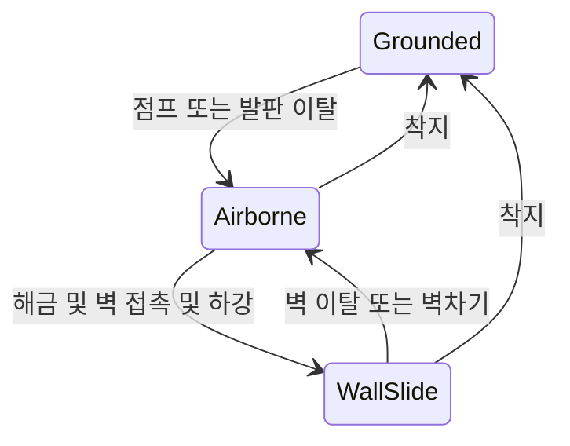

# 벽 감지와 벽 이동 능력 해금 — 설계 검토

진행 상태 갱신(2026-10-27): 벽 미끄러짐·벽차기·책임 분리 후 벽 코요테 타임을 추가했다. 최신 검증은 Unity 109개이며 Docs/Reports/2026-10-27-wall-coyote.md를 따른다. 현재 구조는 PlayerMovement(수평·중력·물리), PlayerJump(공통 점프), PlayerWallJump(벽차기·벽 코요테), PlayerWallSlide(미끄러짐), PlayerLocomotion(입력·센서·우선순위 조정)이다. 이전 책임 분리의 92개/374샘플과 벽차기 65개·미끄러짐 66개는 당시의 역사적 근거다.

## 최신 벽차기 조작감 보정 — 2026-10-27

사용자 요청: 벽 이탈 직후에도 벽차기 입력을 허용한다. PlayerWallJump.wallCoyoteTime은 지상 코요테와 독립된 임시 0.1초 설정이다. 현재 접촉 우선, 이탈 후 마지막 유효 벽 기억, 한 번 사용 시 기록 소비, 착지·입력 차단·이동 상태 초기화 시 취소한다. 상승 중 사용과 실제 재접촉 후 같은 벽 반복은 유지한다. 이 보정이 이전의 현재 접촉 필수 동작보다 우선한다. 구현·새 Unity 109개 검사·임시 도구 정리와 최종 컴파일을 완료했다. 사용자 조작감 리뷰는 대기 중이며 전체 근거는 Docs/Reports/2026-10-27-wall-coyote.md를 따른다.

## 최신 범위 결정

2026-10-26 사용자 결정: 벽 미끄러짐은 긍정적으로 검토됐고 벽 매달리기는 프롤로그와 첫 숲 범위에서 제외한다. 원본 GDD의 F 세 동작 묶음 해금, WallCling 입력과 상태, G3 매달리기 학습 요구보다 이 결정을 우선한다. F에서는 미끄러짐과 벽차기만 해금하며 매달리기 전용 입력·상태·애니메이션·VFX·테스트를 만들지 않는다. 후반 별도 획득 방식은 미정이다. G3를 벽차기와 안전한 착지 타이밍 연습으로 바꾸는 것은 추후 레벨 리뷰에서 확인할 제안이다. 아래 구현 전 분석과 Git 실패 내용은 작성 당시 기록이며 현재 진행 판단에는 최신 실행 로그와 보고서를 사용한다.

## 벽차기 방향 제어 정책 — 2026-10-27 사용자 결정

### 확정한 정책

벽차기 직후에는 짧게 벽 반대 방향의 수평 도약을 보장한 뒤 기존 가속·감속 방식으로 방향 제어를 복구한다. 벽 쪽 방향키를 계속 누르고 있어도 발사 직후 수평 도약이 즉시 상쇄되지 않게 한다. 제한 시간은 구현 시 SerializeField로 노출해 Inspector에서 조절할 수 있게 한다.

예상 흐름: 오른쪽 벽에서 벽차기 발동 → 왼쪽으로 수평 도약 유지 → 제한 시간 종료 → 기존 수평 가속·감속 계산 재개. 제한 시간이 길수록 도약은 확실해지지만 조작 복구가 늦게 느껴질 수 있으므로 실제 플레이로 조정한다. 이는 수평 방향 제어 정책이며 중력이나 점프 버튼 해제까지 함께 정지하는 입력 잠금을 뜻하지 않는다.

상승 중 벽차기는 필수다. 벽 이동 능력이 해금된 공중 상태에서 유효한 벽에 접촉하면 상승·정점·하강 여부와 관계없이 점프 입력으로 벽차기를 사용할 수 있어야 한다. IsWallSliding이나 하강 시작을 선행 조건으로 요구하지 않는다. 예: 일반 점프로 상승하면서 오른쪽 벽 접촉 → 점프 버튼을 새로 누름 → 왼쪽 위로 벽차기. 버튼 유지의 자동 반복이나 공유 버퍼 세부는 별도 검토한다.

같은 벽에서도 실제로 접촉을 벗어났다가 재접촉한 뒤 새로운 점프 입력을 하면 다시 벽차기가 가능해야 한다. 버튼을 유지하기만 해서는 자동 반복하지 않는다. 이 정책과 함께 사용자가 2026-10-27 벽차기 개발 시작을 명시적으로 승인했다.

### 이번 구현의 세부 정책과 임시값

- 0.1초는 현재 PlayerWallJump의 테스트용 설정이며 최종 수치가 아니다. 수평/수직 속도와 제어 시간은 해당 컴포넌트 Inspector에 있다. 기본 이동 씬의 수평 속도 오버라이드 4는 보존했고 프리팹/벽차기 씬은 8이다.
- 기존 점프 높이 조절과 공유 버퍼를 벽차기에 재사용한다. 지상 점프 → 유효 벽차기 → 코요테 점프 순서로 한 입력을 한 번만 소비하며, 벽차기 뒤 지상/코요테 점프 권한이 남지 않게 한다. 이는 이번 구현에서 채택한 세부 정책이다.
- 양쪽 벽이 동시에 감지되면 방향 입력으로 딛을 벽을 선택하며, 무입력에는 임의 방향을 고르지 않는다. 각 측면의 재사용 제한은 해당 측면 접촉을 벗어나야 해제한다. 착지·입력 비활성화·Movement 비활성화 시 제어 제한을 정리하고, 센서·능력이 비활성화되면 다음 물리 틱에서 제한을 종료한다.
- 벽차기 코드·프리팹·전용 씬 연결을 완료했고 Unity 검사 65개(8 Editor + 57 Play Mode)가 통과했다. wallJumpHorizontalSpeed=8u/s, wallJumpVerticalSpeed=16u/s, wallJumpControlLockTime=0.1s를 임시 Inspector 값으로 사용한다. F 이벤트와 영구 저장은 이번 구현 범위에 없다.

### 검증 및 이후 직접 확인 계획

분리 이전에는 PlayerMovement의 FixedUpdate/CalculateVelocity가 이 흐름을 처리했다. 현재는 PlayerLocomotion이 순서를 조정하고 개별 기능이 정책을 계산하며 PlayerMovement가 물리에 적용한다. Unity 65개 검사와 임시 도구 제거 후 최종 7개 C# 소스의 별도 컴파일을 완료했다. 실제 제어 복구는 해당 검사에서 0.120초였고, 벽차기 유지/짧은 입력 높이는 3.208/1.004u였다. 이는 특정 테스트 조건의 측정값이다. 상세 로그와 직접 확인 순서는 최신 벽차기 보고서를 따른다.

구현 후 확인할 시나리오: 좌우 벽 각각에서 벽 쪽 방향키를 누른 채 점프해 반대 방향 도약을 확인하고, 설정 시간이 지난 뒤 방향 제어가 기존 가속·감속으로 돌아오는지 확인한다. 제한 시간을 바꿨을 때 실제 제어 복구 시점이 바뀌는지도 검사한다. 추가로 좌우 벽 각각에서 상승 중 접촉 직후 점프 입력이 벽차기로 이어지는지, 하강이나 미끄러짐을 기다리지 않는지 검사한다. 능력 미해금 상태에서는 상승 중에도 발동하지 않아야 한다. 전용 PlayerWallJumpTest 씬에서 직접 조작감을 검토한다. 아래 1~9절은 이전 벽 미끄러짐 설계 당시 기록이며 최신 상태보다 우선하지 않는다.

작성: 2026-10-26. 기준 프로젝트: ETHEREAN / Unity 6000.4.7f1.

## 1. 목표와 완료 여부

다음 작은 개발 단위의 설계를 완료했다. 대상은 **벽 감지와 능력 보유 조건을 바탕으로 한 벽 미끄러짐**이다. 이번 문서는 설계이며 새 런타임 코드·프리팹·씬·입력 바인딩을 구현하지 않았다. 벽차기는 이후 별도 검토 단위이며 벽 매달리기는 이번 범위에서 제외한다.

기초 이동의 로컬 커밋도 요청받았지만, 현재 실행 환경이 `.git/index.lock` 생성을 `Permission denied`로 거부했다. 스테이징과 커밋은 완료되지 않았다. Git 권한이나 저장소 메타데이터를 변경하지 않았다. 로컬 터미널에서 실행할 정확한 34개 파일 목록을 `Docs/Tools/CommitBasicMovement.ps1`에 준비했다. 이 스크립트는 다음 설계 문서·자기 자신·개인 IDE/도구 설정·SceneTemplateSettings.json을 포함하지 않는다.

## 2. 근거, 현재 구조와 변경할 파일

GDD 3.7.5 및 5.5 F/G, 5.7과 마스터 프롬프트 2.1/2.5를 확인했다.

| 구분 | 내용 |
| --- | --- |
| 최신 요구 | F에서 배우기 전 벽 미끄러짐·벽차기 불가. 매달리기는 이번 범위 제외 |
| 최신 요구 | F에서 미끄러짐과 벽차기를 하나의 능력으로 해금. 스킵·재방문·사망 뒤에도 획득 사실 유지 |
| 최신 요구 | 획득 후 벽 접촉 시 미끄러짐, 점프로 반대 방향 벽차기 |
| 최신 요구 | WallSlide 중 공격 시작 불가. 벽에서 떨어져 일반 공중 상태가 되면 공중 공격 가능 |
| 현재 구현 | GroundSensor, 추상 입력 계약, New Input Reader, Movement 한 곳의 X/Y 속도 적용 |
| 현재 미구현 | 벽 센서, 벽 능력 보유 상태, 벽 이동 동작, 실제 F 이벤트, GameProgress/저장 시스템 |
| 입력 현황 | Player/Move와 Player/Jump 재사용 가능. WallCling 액션은 제외하며 추가하지 않음 |

프로젝트 루트: `C:\Users\pjw\OneDrive\Desktop\UnityGithub\ETHEREAN`.

다음 구현을 승인받으면 변경할 파일:

| 파일(루트 기준) | 책임/변경 |
| --- | --- |
| `Assets/_Project/Scripts/Runtime/Player/PlayerWallSensor.cs` 추가 | 좌우 벽 접촉 사실과 표면 방향만 검사. 속도·능력·입력 판단 없음 |
| `Assets/_Project/Scripts/Runtime/Player/PlayerTraversalAbilities.cs` 추가 | 현재 플레이어의 벽 이동 능력 보유 여부. 기본 잠금, 읽기 전용 공개 프로퍼티, 중복 호출에 안전한 해금 메서드 |
| `Assets/_Project/Scripts/Runtime/Player/PlayerMovement.cs` 수정 | 능력·접촉·지상/공중·상승/하강 조건을 결합하고 벽 미끄러짐의 낙하 상한을 기존 수직 계산에 적용 |
| `Assets/_Project/Prefabs/Player/Player.prefab` 수정 | 센서/능력 컴포넌트와 Movement 참조 연결. 기본 잠금 상태 유지 |
| `Assets/_Project/Scenes/Tests/PlayerMovementTest.unity` 수정 | 기존 씬을 보존하며 높은 좌우 수직 벽의 확인 구간을 Editor API로 추가 |
| `Assets/_Project/Scripts/Editor/PlayerMovementTestSceneBuilder.cs` 수정 | 이후 처음 생성하는 테스트 에셋에도 동일한 연결 적용 |

벽 미끄러짐에는 새로운 입력 액션이 필요 없다. WallCling 바인딩과 매달리기용 Reader 계약 확장은 이번 범위에 추가하지 않는다. 미리 사용하지 않을 입력이나 범용 인터페이스를 추가하지 않는다.

## 3. 클래스 구조, 실행 순서와 상태 전환

`PlayerWallSensor.CheckWalls()`가 좌/우 접촉을 담은 작은 값 결과를 반환하는 방안을 제안한다. 센서가 자체 FixedUpdate에서 캐시를 갱신하지 않고, Movement가 자신의 물리 틱에서 직접 호출해 갱신 순서 차이를 피한다.

센서는 기존 CapsuleCollider2D의 좌우 Cast를 사용한다. 레이어와 트리거를 필터링하고 자기 충돌체를 제외한다. 히트 법선과 검사 방향의 내적으로 벽에 가까운 면만 허용해 바닥·천장·완만한 경사를 제외한다. 좌우 결과는 동시에 참일 수도 있다. 미끄러짐의 수직 제한에는 어느 한쪽 접촉이면 충분하며, 양쪽 동시 접촉 시 벽차기 방향 선택은 벽차기 단위에서 결정한다.

`PlayerTraversalAbilities`는 능력 보유와 실행 상태를 구분한다. `WallTraversalUnlocked`는 외부에서 직접 대입하지 않고 `UnlockWallTraversal()`로 해금한다. 같은 인스턴스의 비활성화나 지상/공중 전환은 보유 능력을 지우지 않는다. 테스트용 Inspector 초기값은 가능하지만 **다른 씬/새 인스턴스/재실행까지 영구 보존하는 구현이 끝났다는 뜻은 아니다**. 실제 영구 사실의 소유자는 나중에 승인받아 만드는 GameProgress이며, F 이벤트와 저장 연결은 해당 작업에서 구현한다.

제안 실행 순서:

1. 기존 입력과 바닥 상태 갱신.
2. 좌우 벽 센서 쿼리.
3. 기존 지상/코요테/버퍼 점프를 우선 처리. 발동한 점프를 벽 감속으로 즉시 취소하지 않음.
4. 능력 해금 + 공중 + 유효 벽 접촉 + 하강 중인지 확인.
5. 조건을 만족하면 계산된 Y속도가 `-wallSlideSpeed`보다 작아지지 않게 제한.
6. 기존 X/Y 속도를 PlayerMovement가 한 번에 Rigidbody2D에 적용.

| 조건 | 제안 결과 |
| --- | --- |
| 능력 미보유 | 기존 이동·점프·낙하 유지. 벽 접촉이 능력을 부여하지 않음 |
| 지상 | Grounded. 벽 옆이라는 이유로 WallSlide에 진입하지 않음 |
| 해금 + 상승 중 벽 접촉 | 상승 속도 유지. 하강 전환 후 미끄러짐 판정 |
| 해금 + 공중 하강 + 벽 접촉 | WallSlide, 낙하 속도 제한 |
| 벽에서 떨어짐 | Airborne, 기존 낙하 중력과 최대 낙하 속도 복귀 |
| 벽을 따라 내려와 착지 | Grounded, 기존 점프 권한 복구 |

WallSlide는 지상이 아니다. IsGrounded, 지상 점프 권한, 마지막 지상 시각을 벽 접촉으로 갱신하지 않는다. 벽차기를 구현하기 전에는 벽에서 Space를 누른 것만으로 추가 점프하지 않는다. 다만 기존 코요테 조건이 유효한 점프 또는 착지 시 버퍼 점프는 유지한다.

아래는 최종 벽 이동 전체의 **예정된** 상태 전환이다. 이번에 구현한 상태 머신이 아니다.

벽차기 전이는 구현 승인을 받은 뒤 추가한다. WallCling은 제외한다. 잠금 상태에서는 WallSlide로 전환하지 않는다.

## 4. 설계 이유와 트레이드오프

센서는 공간적 사실, 능력 컴포넌트는 보유 여부, Movement는 실제 이동을 담당한다. 입력/물리 쿼리/능력 데이터를 전부 한 Controller에 넣거나 다른 컴포넌트에서 Rigidbody 속도를 덮어쓰지 않는다. 단순 bool 하나를 위해 저장 서비스나 범용 능력 인터페이스, 전역 싱글턴을 만들지 않는다.

첫 실제 구현은 센서와 보유 bool을 따로 만든 뒤 소비하지 않는 단계보다, **잠금 조건을 갖춘 벽 미끄러짐**을 하나의 플레이 가능한 검토 단위로 완성하는 방향을 추천한다. 벽차기·매달리기·전체 HFSM 교체까지 한 번에 묶지는 않는다.

상승 중에는 벽 감속을 적용하지 않는 정책과 벽 방향 입력 없이 접촉만으로 자동 미끄러지는 정책은 **설계 제안**이다. GDD의 벽 접촉 시 미끄러짐 요구를 출발점으로 하되, 세부 조작 조건은 사용자 검토 후 확정한다.

## 5. 확인한 것과 아직 검증하지 않은 것

- Git 상태·기존 코드·Unity 버전·패키지·씬/프리팹·Input Actions·asmdef 부재와 GDD 관련 부분을 확인했다.
- 기존 코드의 별도 Roslyn C# 컴파일은 2026-10-26 성공했다. Inspector 참조 필드에 대한 CS0649 경고 2개와 컴파일 오류를 구분했다.
- 이전 점프 버퍼의 Unity 44개 검사(6 Editor + 38 Play Mode) 기록을 확인했다. 이번 설계의 테스트 결과로 세지 않는다.
- 현재 저장 프리팹은 jumpSpeed=16, riseGravity=42, fallGravity=48, coyoteTime=0.1, jumpBufferTime=0.1, jumpCutMultiplier=0.5다. 이전 검사 당시 코요테 0.2와 구분한다.
- 이번 작업은 설계이므로 벽 이동 런타임 검사나 영구 해금/저장 검사를 실행하지 않았다.
- Git add는 `.git/index.lock: Permission denied`로 실패했다. 커밋 해시는 없고 원격 전송도 없다. 이 환경에서 재시도하거나 접근 권한을 바꾸지 않았다.

## 6. 다음 구현 후 직접 확인할 방법과 인수 조건

다음은 아직 실행하지 않은 테스트 계획이다.

1. 기존 PlayerMovementTest 씬에서 기초 이동 회귀: 가속·감속, 일반/가변 점프, 코요테·버퍼·천장 충돌 확인.
2. 능력 잠금 상태로 양쪽 벽에 뛰어 접촉해도 기존 낙하와 동일해야 함. 벽 미끄러짐·벽차기 금지.
3. 테스트에서만 해금 후 높은 좌/우 벽에 접촉하며 하강하면 미끄러짐 속도 상한 적용. 벽을 떠나면 정상 낙하 복귀.
4. 상승 중 벽에 닿아도 점프 상승을 조기에 자르지 않아야 함. 접지와 벽 상태가 동시에 지상 권한을 복구하면 안 됨.
5. 벽 옆 바닥·천장·완만한 경사·트리거·제외 레이어·자기 몸체를 벽으로 잘못 판정하지 않아야 함. 경계/모서리도 검사.
6. 양쪽 동시 접촉은 양쪽 사실을 정확히 반환하고, 수직 제한이 중복 적용되지 않아야 함.
7. Reader/Movement/Player 비활성화·재활성화 시 버퍼·중력 복구가 유지돼야 함. 능력 보유 사실은 같은 인스턴스의 컴포넌트 토글로 사라지지 않아야 함.
8. 실제 F 이벤트와 사망/씬 전환/재실행 후 영구 해금 보존은 진행 데이터 연결 시 별도로 검사. 테스트용 bool 토글로 완료 처리하지 않음.

## 7. 임시값과 미결정 사항

| 제안값 | 의미 | 상태 |
| --- | --- | --- |
| wallCheckDistance=0.05u | 좌우 검사 거리 | 임시 제안, 미측정 |
| 수직 벽 대비 허용 기울기 15도 | 벽 법선 필터 범위 | 임시 제안, 자연 지형에서 조정 필요 |
| wallSlideSpeed=3u/s | 벽 미끄러짐 낙하 상한 | 임시 제안, 미측정 |
| wallTraversalUnlocked=false | 테스트 프리팹 초기 보유 상태 | GDD의 획득 전 잠금에 맞춘 초기 조건 |

낮은 턱의 발끝 접촉과 유효한 벽 이동 표면의 구분, 실제 자연 지형의 벽 각도, 벽차기 수평 발사력과 입력 제한 시간은 해당 구현 단계의 검토·측정 대상이다. 플레이어 높이·점프를 바꾸지 않고 현재 콜라이더 0.8×1.8u를 출발점으로 한다.

## 8. 검토할 쟁점

추천 정책: **능력 획득 후에는 하강 중 벽에 닿으면 벽 방향 입력 없이 미끄러짐을 시작하고, 상승 중 접촉은 상승을 유지한다.** 벽 방향을 계속 누르는 조건을 추가할지 사용자 검토를 기다린다. 잠금 전 사용 불가는 GDD 확정 조건이다.

## 9. 다음 작업 추천

벽 미끄러짐의 남은 정리와 보고 후 다음 구현 후보는 **벽차기**다. 사용자가 별도 지시한 뒤 착수한다. 매달리기는 제외하며 실제 F 이벤트·저장/불러오기도 자동으로 착수하지 않는다.