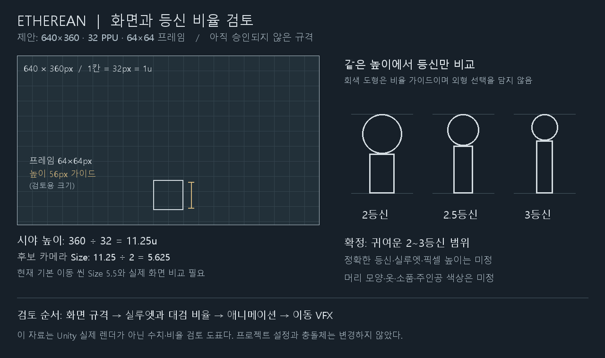

# 화면 규격과 등신 비율 검토 — 2026-10-27

현재 기준(2026-10-28): 귀여운 2등신을 선택했고, 캐릭터 표시 높이 40px를 임시 작업 기준으로 사용한다. 40px는 확정값이 아니며 언제든 변경할 수 있다. 숲 분위기는 B이며, 구체 외형·기준 화면·PPU·캔버스 크기는 최종 확정되지 않았다. 아래 과거 비교 자료와 실제 저장된 Unity 샘플의 60px 가이드는 이 최신 결정과 구분한다.

## 비교 자료

640×360 화면에 32px 간격의 1u 격자를 실제 픽셀 크기로 그렸다. 64×64 프레임과 높이 56px는 비교용 가이드다. 기존 0.8×1.8u 충돌체의 32 PPU 환산은 25.6×57.6px이며, 그림 높이나 실루엣과 동일한 값으로 취급하지 않는다. 인물 도형은 같은 표시 높이에서 머리/전체 비율만 다르게 그렸으며 주인공 외형·색상·의상이나 2.5등신 채택을 의미하지 않는다.

## 추천 검토안

- 기준 화면 640×360, 월드 32 PPU, 기본 타일 32×32, 일반 캐릭터 프레임 64×64를 첫 샘플 후보로 사용한다.
- 출력 1280×720과 1920×1080에서는 각각 정수 2배·3배가 된다. 실제 Unity 픽셀 카메라 설정과 출력은 아직 검증하지 않았다.
- 세로 시야 360/32=11.25u, 카메라 Size 후보 5.625다. 기존 기본 이동 씬 5.5와 비교한 뒤 결정한다. 벽차기 테스트 씬의 별도 카메라 값은 이 일반 화면 후보와 구분한다.
- 캐릭터 정확한 등신·시각 높이·머리와 의상·색·대검 디자인은 이후 검토한다. 이전 생성 이미지의 소녀를 참조하거나 선택하지 않는다.

## 이번 변경과 확인

추가: 이 문서와 같은 폴더의 2026-10-27-pixel-scale-review.png. 기존 아트 제안의 규격을 시각적으로 검토하기 위한 자료다. PNG는 Pillow로 새로 그린 수치 도표이며 기존 이미지를 편집한 것이 아니다.

확인: 1280×760 PNG 생성, 기준 프레임 640×360과 등신 산술 관계 확인. 미검증: 실제 게임 렌더·픽셀 흔들림·가독성·애니메이션·주인공 디자인. Unity 파일·코드·프리팹·입력·충돌체·기존 수치는 변경하지 않았다.

다음 검토: 이 규격으로 Unity 샘플을 만들지 선택한 뒤 별도 작은 작업으로 실제 화면을 비교한다. 주인공 외형이나 다음 기능을 자동 제작하지 않는다.

## 실제 Unity 비교 자료 추가

사용자 승인으로 별도 PlayerPixelScaleTest 씬을 만들었다. Unity 실렌더의 후보/기준 캡처와 새25개 검사 결과는 ../Reports/2026-10-27-pixel-scale-unity.md를 따른다. 새 가이드는 머리 높이를 픽셀 정수로 맞추기 위해 전체60px, 머리30/24/20px를 사용한다. 이 문서의56px 도표와 새60px 모두 크기 검토 예시이며 최종 주인공 크기가 아니다. 실제 화면을 비교하도록 승인한 것이 기술 규격이나 외형 확정을 의미하지 않는다.

## 2026-10-28 최신 선택과 크기 피드백

사용자는 2등신을 선택했고 현재60px 가이드가 너무 크게 느껴진다고 평가했다. 이전2~3등신 미정 범위보다 이 선택을 우선한다. 외형·의상·색·정확한 높이는 미정이다.

비교 자료: 2026-10-28-two-head-size-review.png. 같은640×360 화면에서40/48/60px는 각각11.1/13.3/16.7% 높이다. 40px를 첫 축소 후보로 추천하며 최종값은 선택 대기다. PNG는 Pillow로 새로 그린 비율 도표이며 Unity 렌더/최종 스프라이트가 아니다. 화면 패널은1/2 표시이고 아래 도형은2배 확대다. 실제 출력에서의 크기·표현 품질은 아직 검증하지 않았다.

추가 파일은 이 PNG 하나이며 이 문서의 최신 선택 구역과 AGENTS.md의 Latest art decision만 갱신했다. 코드·씬·충돌체·카메라·스프라이트 에셋은 이번에 변경하지 않았다. 크기를 선택한 뒤 시각 크기와 충돌체/이동 지형의 관계를 별도 검토한다.

## 40px 임시 기준 기록 — 사용자 후속 결정

캐릭터의 투명 여백을 제외한 표시 높이를 우선 40px로 둔다. 최종 규격 확정이 아니며 언제든 변경할 수 있다. 2등신은 선택된 비율이고 40px는 임시 크기이므로 따로 관리한다. 단순 비율 가이드는 머리 20px, 나머지 몸 20px로 비교할 수 있으나 머리 모양·머리카락·장식까지 확정한 것은 아니다.

640×360 후보 화면에서는 높이의 약 11.1%이고, 32 PPU 후보에서는 1.25u에 해당한다. 이 산술 관계가 화면·PPU·충돌체 변경 승인을 뜻하지 않는다. 기존 충돌체는 0.8×1.8u이며, 저장된 Unity 비교 가이드는 아직 60px다. 이번에는 기록만 변경했으며 40px Unity 적용이나 동작 검증은 수행하지 않았다.

다음 검토는 [주인공 실루엣과 대검 비율](2026-10-28-protagonist-silhouette-review.md)이다. 해당 문서의 검 크기와 휴대 자세는 제안이며 사용자 결정이 아니다.