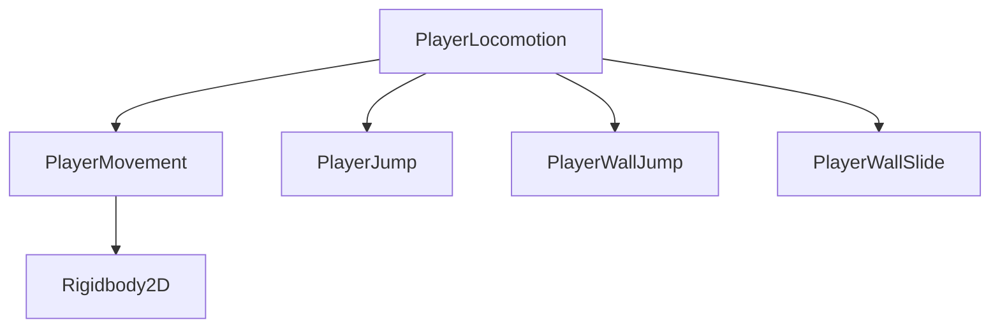

# 플레이어 이동 책임 분리 보고 — 2026-10-27

## 1. 목표와 완료 여부

기존 점프·벽차기 조작을 보존하면서 PlayerMovement에서 입력·점프·벽 동작의 정책과 상태를 분리한다. 코드 분리와 프리팹/세 테스트 씬의 Inspector 이전·검증을 완료했다. 새 Unity 검사 92개(20 Editor + 72 실제 Play Mode)와 구 구현 374개 물리 샘플 대조가 통과했고, 임시 도구 정리 후 최종 11개 C# 소스의 별도 컴파일도 성공했다. 사용자 리뷰는 대기 중이다. 신규 능력·스탯·전투·아트·VFX·F 이벤트·저장·커밋·푸시는 이번 범위에 포함하지 않는다.

## 2. 수정·추가한 파일

| 구분 | 전체 경로 | 변경 위치·책임·연결 |
| --- | --- | --- |
| 수정 | `C:\Users\pjw\OneDrive\Desktop\UnityGithub\ETHEREAN\Assets\_Project\Scripts\Runtime\Player\PlayerMovement.cs` | PlayerMovement: 수평 가속·감속, 상승·낙하 중력, Rigidbody2D 속도·중력 소유권만 유지. BeginMovement/EndMovement, CalculateHorizontalSpeed/CalculateGravitySpeed, ApplyVelocity 및 활성화 이벤트 |
| 수정 | `C:\Users\pjw\OneDrive\Desktop\UnityGithub\ETHEREAN\Assets\_Project\Scripts\Editor\PlayerMovementTestSceneBuilder.cs` | Create(bool): PlayerLocomotion과 기능 컴포넌트 생성, SerializedObject로 여덟 참조 연결. 기존 벽 씬 생성·덮어쓰기 방지 유지 |
| 수정 | `C:\Users\pjw\OneDrive\Desktop\UnityGithub\ETHEREAN\Assets\_Project\Prefabs\Player\Player.prefab` | Player에 Jump/WallJump/WallSlide/Locomotion 추가. 기존 Movement의 점프·벽 수치를 각 컴포넌트로 이전하고 조정자 참조 연결. 원본 능력 잠금 유지 |
| 수정 | `C:\Users\pjw\OneDrive\Desktop\UnityGithub\ETHEREAN\Assets\_Project\Scenes\Tests\PlayerMovementTest.unity` | Player 프리팹 인스턴스의 기존 wallJumpHorizontalSpeed=4 오버라이드를 새 PlayerWallJump 대상으로 이전. 위치·Visual 크기·wallLayers=51·해금=true 유지 |
| 검증·내용 유지 | `C:\Users\pjw\OneDrive\Desktop\UnityGithub\ETHEREAN\Assets\_Project\Scenes\Tests\PlayerWallSlideTest.unity` | 새 프리팹 구조의 상속·참조·기능별 설정을 확인. 기존 씬 내용·지형·능력 잠금 유지 |
| 검증·내용 유지 | `C:\Users\pjw\OneDrive\Desktop\UnityGithub\ETHEREAN\Assets\_Project\Scenes\Tests\PlayerWallJumpTest.unity` | 새 프리팹 구조의 상속을 확인. 씬 내용, 저장 값 8/16/0.1, 위치·지형·테스트 해금 유지 |
| 추가 | `C:\Users\pjw\OneDrive\Desktop\UnityGithub\ETHEREAN\Assets\_Project\Scripts\Runtime\Player\PlayerJump.cs` | 일반 점프 자격·코요테·공유 버퍼·가변 높이. 조정자가 UpdateState/CanGroundJump/HasBufferedJump/StartJump/ApplyJumpCut 호출 |
| 추가 | `C:\Users\pjw\OneDrive\Desktop\UnityGithub\ETHEREAN\Assets\_Project\Scripts\Runtime\Player\PlayerJump.cs.meta` | Unity가 생성한 해당 MonoBehaviour 스크립트 GUID. Player.prefab에서 참조 |
| 추가 | `C:\Users\pjw\OneDrive\Desktop\UnityGithub\ETHEREAN\Assets\_Project\Scripts\Runtime\Player\PlayerWallJump.cs` | 벽 선택·도약 속도·짧은 수평 제어 제한·측면별 이탈/재접촉. 조정자가 UpdateContacts/TryJump/IsControlLocked 호출 |
| 추가 | `C:\Users\pjw\OneDrive\Desktop\UnityGithub\ETHEREAN\Assets\_Project\Scripts\Runtime\Player\PlayerWallJump.cs.meta` | Unity가 생성한 해당 MonoBehaviour 스크립트 GUID. Player.prefab에서 참조 |
| 추가 | `C:\Users\pjw\OneDrive\Desktop\UnityGithub\ETHEREAN\Assets\_Project\Scripts\Runtime\Player\PlayerWallSlide.cs` | 수동 상태 초기화와 하강 속도 제한. 조정자가 ResetState/LimitFallSpeed 호출 |
| 추가 | `C:\Users\pjw\OneDrive\Desktop\UnityGithub\ETHEREAN\Assets\_Project\Scripts\Runtime\Player\PlayerWallSlide.cs.meta` | Unity가 생성한 해당 MonoBehaviour 스크립트 GUID. Player.prefab에서 참조 |
| 추가 | `C:\Users\pjw\OneDrive\Desktop\UnityGithub\ETHEREAN\Assets\_Project\Scripts\Runtime\Player\PlayerLocomotion.cs` | 유일한 FixedUpdate와 입력 소비, 센서 조회, 지상→벽→코요테 우선순위와 생명주기 조정. Rigidbody 직접 접근 없음 |
| 추가 | `C:\Users\pjw\OneDrive\Desktop\UnityGithub\ETHEREAN\Assets\_Project\Scripts\Runtime\Player\PlayerLocomotion.cs.meta` | Unity가 생성한 해당 MonoBehaviour 스크립트 GUID. Player.prefab에서 참조 |
| 수정 | `C:\Users\pjw\OneDrive\Desktop\UnityGithub\ETHEREAN\AGENTS.md` | Current review unit: 이번 명시적 리팩터링 승인, 책임 경계·설정 이전·검증·리뷰 상태 |
| 수정 | `C:\Users\pjw\OneDrive\Desktop\UnityGithub\ETHEREAN\PLAYER_SETUP.md` | 최신 책임 분리 구역: Inspector 위치, 참조, 직접 확인과 컴포넌트 토글 정책 |
| 수정 | `C:\Users\pjw\OneDrive\Desktop\UnityGithub\ETHEREAN\Docs\Design\2026-10-26-wall-movement.md` | 최신 구현 상태: 기능/조정자 책임과 최신 보고서 연결. 이전 설계 기록은 보존 |
| 수정 | `C:\Users\pjw\OneDrive\Desktop\UnityGithub\ETHEREAN\Docs\Plans\ETHEREAN_Daily_Plan_2026-11-08.md` | DAY 02와 변경 이력: 벽차기 후 승인된 책임 분리 작업 및 리뷰 대기. 아트·VFX와 실제 B/I 게이트 미완료 유지 |
| 추가 | `C:\Users\pjw\OneDrive\Desktop\UnityGithub\ETHEREAN\Docs\Reports\2026-10-27-locomotion-refactor.md` | 이 기능의 9개 보고 항목, 설정 이전 근거와 실제 새 검사 로그 |

이전 구현과 원본 문서를 유지하며, 기존 파일 삭제·이름 변경은 없다. 검증용 이전 구현 복사본과 임시 Editor/Play 도구 및 임시 복제 씬은 모두 제거했다. 파일 목록과 실행 근거는 검증 구역에 기록한다. 기존 스크립트·프리팹·씬의 .meta GUID는 유지한다.

## 3. 변경 전후와 실제 실행 흐름

이전 PlayerMovement는 입력 버퍼, 코요테, 점프 컷, 벽 선택, 재접촉 제한, 수평 제어 제한, 미끄러짐, 가속·중력과 Rigidbody 적용을 함께 소유했다. 이제 각 정책과 시간·상태는 해당 기능에 있고 조정자는 순서와 우선순위만 관리한다.



1. PlayerLocomotion.FixedUpdate가 활성 Movement를 확인하고 물리 제어를 시작한다. 이 조정자만 FixedUpdate를 가진다.
2. WallSensor.CheckWalls를 한 번 조회하고, 능력·센서·입력 활성 여부를 WallJump.UpdateContacts에 전달한다. 벽차기의 재사용 제한과 제어 복구 시각은 WallJump에만 있다.
3. CalculateVelocity가 Jump 누름·해제·유지·좌우 입력을 한 번 읽고 GroundSensor로 접지를 확인한다. 착지 시 WallJump 상태를 초기화한다.
4. Jump.UpdateState는 접지 시각·점프 자격과 공유 입력 버퍼를 갱신한다. 수평 제어가 보호되는 동안에는 현재 X속도를 유지하고, 나머지 경우 Movement.CalculateHorizontalSpeed로 기존 가속·감속을 계산한다.
5. TryStartJump가 지상 점프 → 유효 벽차기 → 코요테 점프 순서로 한 가지 행동만 선택한다. WallJump.TryJump는 도약 속도만 반환한다. Jump.StartJump가 버퍼·지상/코요테 자격을 한 번 소비하고 초기 컷을 처리한다.
6. 점프를 시작하지 않은 공중 틱은 Jump.ApplyJumpCut → Movement.CalculateGravitySpeed → WallSlide.LimitFallSpeed 순서로 Y속도를 계산한다. 상승 중 벽차기, 조기 해제, 낙하 강화와 벽 낙하 상한의 기존 수식·순서는 유지한다.
7. 마지막에 Movement.ApplyVelocity가 최종 X/Y를 Rigidbody2D에 적용한다. 다른 기능과 조정자는 Rigidbody2D를 직접 읽거나 쓰지 않는다.
8. Reader.InputDisabled는 조정자가 받아 Jump 버퍼와 WallJump 제어 제한을 즉시 취소한다. Movement 활성화 이벤트는 전체 일시 상태를 초기화하고 물리 제어를 재획득한다. Movement/조정자 비활성화 시 Movement.EndMovement가 X정지·기존 gravityScale 복구를 담당한다.

공개 상태 조회 위치는 `PlayerMovement.IsGrounded/IsWallSliding`에서 `PlayerLocomotion.IsGrounded/IsWallSliding`으로 이동했다. 이 프로젝트의 다른 런타임 소비자는 없었고 생성 도구·검증기는 새 위치에 맞췄다. 호환용 중복 상태나 구 필드를 남기지 않는다.

## 4. 설계 이유와 트레이드오프

- SRP: 이동 공식, 공통 점프 처리, 벽차기 규칙, 미끄러짐 규칙, 실행 순서를 각각 분리한다. 핵심 메서드는 internal로 제한하며 Inspector 수치는 private SerializeField로 보존한다.
- 조합: 기능끼리 서로를 직접 호출하거나 입력을 별도로 소비하지 않는다. 조정자가 결과를 받아 조합하므로 일반 점프와 벽차기가 같은 요청을 중복 소비하지 않는다.
- 단일 물리 소유자: Rigidbody와 gravityScale을 관리하는 클래스는 PlayerMovement 하나다. 각 기능에 독립적인 FixedUpdate를 두지 않아 실행 순서 경쟁을 피한다.
- 기존 PlayerMovement 컴포넌트 GUID를 유지한 채 직렬화 수치를 실제 새 소유자로 이전했다. FormerlySerializedAs나 레거시 필드를 추가하지 않는다. 미사용 인터페이스·SO 스탯·전체 HFSM·범용 명령 시스템을 도입하지 않는다.
- 파일·컴포넌트와 Inspector 연결은 늘어난다. 대신 벽차기 제어 시간을 고칠 때 입력 버퍼나 Rigidbody 소유권까지 함께 수정할 필요가 없다. PlayerMovement는 빈 줄 포함 286→80줄이다. PlayerJump 99줄, PlayerWallJump 70줄, PlayerWallSlide 28줄, PlayerLocomotion 153줄이며 각 파일이 맡는 변경 이유를 분리했다. 총 줄 수 감소나 성능 최적화를 목표로 한 변경은 아니다.
- PlayerJump는 일반 점프뿐 아니라 벽차기에도 쓰는 공통 요청/높이 조절을 소유한다. 이를 끄면 모든 점프 요청을 처리하지 않는다. 벽차기와 벽 미끄러짐 컴포넌트는 각각 독립적으로 끌 수 있다. 구 조작에서 바뀐 기능 요구가 아니라, 새 분리 컴포넌트의 명시적 비활성화 정책이다.

## 5. 검증 및 설정 이전 근거

소스 제거 전에 Unity Editor API로 프리팹 1개, 저장 씬 3개, 열린 씬 1개의 이전 필드 14개와 위치·Visual 스케일·센서 레이어·해금·Movement 활성 상태를 캡처했다. 열린 씬은 PlayerWallJumpTest였고 dirty=False였다.

- 프리팹: H=6, 가속/감속=40/60, 일반 점프=16, 상승/낙하 중력=42/48, 낙하 상한=20, 컷=0.5, 코요테/버퍼=0.1/0.1, 벽 미끄러짐=3, 벽차기=8/16/0.1.
- 기본 이동 씬: **wallJumpHorizontalSpeed=4**였으며 새 PlayerWallJump의 씬 오버라이드로 유지했다. 나머지 씬/프리팹과 8로 통일하지 않았다. 기존 위치·Visual Y=1.8·wallLayers=51·테스트 해금=true도 유지했다.
- 저장 씬은 복사본에서 Editor API로 컴포넌트·참조·값을 이전하고 저장한 다음, Unity가 생성한 저장 내용을 원래 파일로 반영했다. .meta를 교체하거나 YAML 수치를 수작업으로 치환하지 않았다. 이전 Movement에 남은 이동 대상 필드의 고아 오버라이드만 제거했다.
- 원래 clean이던 열린 씬은 새 저장본을 다시 열어 같은 값·dirty=False를 확인했다. dirty 씬용 백업 경로도 도구에 준비했으나 이번 실행에서는 해당 경로를 사용하지 않았다.
- 별도 Roslyn 컴파일은 오류 없이 통과했다. 실제 새 Play 검사가 끝나기 전까지 이전 벽차기 65개 통과를 이번 결과로 재사용하지 않는다.

**최종 새 실행: 92개 전부 통과(20 Editor + 72 실제 Play Mode), 실패 0개.** `Logs/LocomotionRefactorValidation.txt`의 SUCCESS/RESTORED를 확인했고 부록에 전체 로그를 보존했다.

- Editor 20개: 프리팹과 세 저장 씬 각각의 14개 값·8개 조정자 참조·위치/크기/레이어/해금/활성 상태·Movement에서 이전 필드 제거 확인(4×4개), 다섯 클래스 중 FixedUpdate 조정자 단독 소유, 다른 네 클래스의 Rigidbody 접근 부재, Movement의 점프 입력/벽 센서 의존 부재, 기존 씬 덮어쓰기 방지 확인(4개).
- Play 72개: 기존 벽차기 단계의 57개 물리 항목을 새 컴포넌트 구조에서 다시 실행했다. 여기에 조정자·개별 기능 비활성화/재활성화 8개와 구 구현 대조 시나리오 7개를 추가했다. 이전 65개 통과 기록을 이번 검사 수로 재사용하지 않았다.
- 실제 New Input System Keyboard 상태 이벤트 → Reader → 조정자 FixedUpdate → Physics2D 결과를 관찰했다. 입력 포커스는 검증용 InputSettings 복사본, 시간 진행은 0.02초 일시 설정으로 격리했다. 종료 시 원본 InputSettings 참조, Time 설정과 가상 장치를 복원/제거했다. 사전 위치·속도·해금은 검증 도구가 설정한 조건이며 자동 테스트를 물리 키보드 조작감 검증으로 표현하지 않는다.
- 대조용 구 클래스는 수정 전 PlayerMovement의 클래스명만 바꾼 임시 복사본이다. 같은 튜닝과 입력을 주고 두 물리 배치를 50u 떨어뜨려 실행했다. 수평 가속/제동, 일반 가변 점프/착지, 착지 버퍼, 코요테, 상승 중 벽차기/같은 벽 입력, 반대 벽 왕복, Reader/Movement/Player 토글의 7개 시나리오에서 **374개 물리 샘플**을 대조했다. 속도와 위치의 합격 허용 오차는 각각 0.005u/s와 0.005u, 접지/미끄러짐 상태는 동일 여부다. 실제 최대 위치 차이는 **0.000030u**, 최대 속도 차이는 로그 소수 6자리 기준 **0.000000u/s**였고 상태 비교가 통과했다.
- 같은 새 실행에서 벽차기 유지/1틱 후 해제 높이 **3.208/1.004u**, 무방향 수평 이동 **1.256u**, 제어 복구 **0.120s**(설정 0.1s, 물리 틱 0.02s)를 기록했다. 실제 B/I 지형의 통과 성능 측정과는 구분한다.
- 기존 스크립트·프리팹·씬의 .meta 바이트를 작업 전과 비교해 보존을 확인했다. 프리팹의 Rigidbody2D·CapsuleCollider2D·Transform·SpriteRenderer YAML 블록도 이전 내용과 같았다. 두 벽 테스트 씬의 내용은 같았고, 기본 이동 씬은 wallJumpHorizontalSpeed=4 오버라이드의 대상 fileID만 새 WallJump로 바뀌었다.
- 원래 활성 WallJumpTest와 열린 씬·dirty=False가 복구됐고 임시 테스트 씬은 제거됐다. 최종 11개 C# 소스를 별도로 새 컴파일해 exit code 0을 확인했다. 기존 Reader Inspector 참조의 CS0649 경고 2개는 컴파일 오류와 구분한다.
- C#/문서의 공백 검사는 별도로 확인한다. 전체 Git diff 공백 검사는 Unity가 새 MonoBehaviour에 직렬화한 빈 `m_Name: `의 뒤 공백 4개를 표시했다. Unity 생성 YAML의 해당 형식을 수작업으로 변경하지 않았다. 코드 오류나 행동 실패를 뜻하지 않는다.

다음 임시 파일과 각 `.meta`를 모두 삭제했다. 최종 기능은 이 파일에 의존하지 않는다.

- `C:\Users\pjw\OneDrive\Desktop\UnityGithub\ETHEREAN\Assets\_Project\Scripts\Editor\LocomotionRefactorBridge.cs`: 이전/적용 값 캡처와 Editor API 설정 이전
- `C:\Users\pjw\OneDrive\Desktop\UnityGithub\ETHEREAN\Assets\_Project\Scripts\Editor\LocomotionRefactorValidationBootstrap.cs`: Editor 검사·Play 시작/종료·씬 복구
- `C:\Users\pjw\OneDrive\Desktop\UnityGithub\ETHEREAN\Assets\_Project\Scripts\Runtime\Player\LocomotionRefactorValidationDriver.cs`: 실제 입력/물리·컴포넌트 토글·구/신 비교
- `C:\Users\pjw\OneDrive\Desktop\UnityGithub\ETHEREAN\Assets\_Project\Scripts\Runtime\Player\LocomotionLegacyReference.cs`: 클래스명만 바꾼 수정 전 구현의 비교 기준

요청·준비·중지 마커와 RefactorCapture/RefactorMigration/RefactorVerify/LocomotionRefactorValidationScene 임시 에셋도 남아 있지 않다. 설정 캡처 JSON과 로그는 Logs에 증거로 남겼다. 이번 작업에서 Git 커밋·푸시는 하지 않았다.

## 6. 직접 확인할 방법

1. Unity에서 PlayerWallJumpTest를 단독으로 연다. Player에 Movement, Jump, Wall Jump, Wall Slide, Locomotion이 각각 있고 Locomotion 참조 8개가 연결돼 있어야 한다.
2. 이동 속도·가속·중력은 PlayerMovement, 일반 점프·컷·코요테·버퍼는 PlayerJump, 벽차기 속도·제어 시간은 PlayerWallJump, 미끄러짐 속도는 PlayerWallSlide에서 조절한다.
3. Play 후 A/D와 Space로 기본 점프, 상승 중 벽차기, 짧은 입력, 같은 벽 재접촉과 마주 보는 벽 왕복을 확인한다. 기존처럼 동작해야 한다.
4. WallJump를 끄면 벽차기만 막히고 일반 점프는 유지된다. WallSlide를 끄면 벽 낙하 제한만 사라지고 벽차기는 유지된다. Jump를 끄면 공통 점프 요청 처리가 중단되며 중력과 미끄러짐은 유지된다.
5. Movement나 Locomotion을 끄면 X속도는 0, Rigidbody의 gravityScale은 원래 값으로 복구된다. 다시 켜면 오래된 점프 요청이나 벽차기 제한이 재실행되지 않아야 한다. Reader를 물리 틱 사이 껐다 켜도 버퍼/제어 제한은 취소된다.
6. PlayerMovementTest에서는 PlayerWallJump의 수평 속도 씬 오버라이드가 4인지 확인한다. 프리팹 원본은 8이며 능력 잠금은 false다. 테스트 씬의 해금은 영구 진행 저장을 뜻하지 않는다.

## 7. 임시값·제한·미검증

수치는 이전값을 옮긴 것이며 새 최종 밸런스를 확정한 것이 아니다. 최종 속도 공급을 캐릭터 스탯으로 옮기는 작업, 실제 자연 지형/B-I 게이트, F 이벤트·영구 저장, 애니메이션·VFX와 게임패드 실기기 검증은 별도다. 물리 키보드 조작감 리뷰는 사용자에게 남아 있다.

## 8. 사용자 검토 지점

각 Inspector의 책임과 조정 흐름이 이해하기 쉬운지, 실제 조작에서 리팩터링 전과 다른 부분이 없는지 검토한다. 단일 물리 소유와 공유 입력 버퍼는 유지하면서 정책을 분리했으며, 전체 전투/제어 상태 시스템까지 완성한 것은 아니다.

## 9. 다음 작업 추천 — 실행하지 않음

먼저 이번 구조와 조작의 사용자 리뷰·필요 수정부터 마친다. 이후 아트 기준/이동 표현 또는 다른 기능은 새 지시 후 진행한다. 이번 작업으로 자동 커밋·푸시하거나 다음 기능을 시작하지 않는다.

## 부록 A: 실제 설정 캡처·이전 로그

```text
CAPTURE 2026-10-27T19:01:26.7635904+09:00
LIVE Assets/_Project/Scenes/Tests/PlayerWallJumpTest.unity dirty=False players=1
CAPTURE COMPLETE: prefab + 3 saved scenes + 1 open scenes
APPLY 2026-10-27T19:06:32.2660349+09:00
SAVED migrated Assets/_Project/Scenes/Tests/PlayerMovementTest.unity values verified
SAVED migrated Assets/_Project/Scenes/Tests/PlayerWallSlideTest.unity values verified
SAVED migrated Assets/_Project/Scenes/Tests/PlayerWallJumpTest.unity values verified
LIVE restored Assets/_Project/Scenes/Tests/PlayerWallJumpTest.unity dirty=False
APPLY COMPLETE: all 14 settings, transforms, masks and ability values preserved
```

## 부록 B: 실제 새 Unity 검증 로그

```text
Locomotion refactor validation 2026-10-27T19:10:38.3880191+09:00
PASS Editor: prefab: all 14 original tuning values preserved on their owners
PASS Editor: prefab: all eight coordinator references connected
PASS Editor: prefab: pose, masks, ability and movement enable preserved
PASS Editor: prefab: removed responsibilities are absent from movement Inspector
PASS Editor: Assets/_Project/Scenes/Tests/PlayerMovementTest.unity: all 14 original tuning values preserved on their owners
PASS Editor: Assets/_Project/Scenes/Tests/PlayerMovementTest.unity: all eight coordinator references connected
PASS Editor: Assets/_Project/Scenes/Tests/PlayerMovementTest.unity: pose, masks, ability and movement enable preserved
PASS Editor: Assets/_Project/Scenes/Tests/PlayerMovementTest.unity: removed responsibilities are absent from movement Inspector
PASS Editor: Assets/_Project/Scenes/Tests/PlayerWallSlideTest.unity: all 14 original tuning values preserved on their owners
PASS Editor: Assets/_Project/Scenes/Tests/PlayerWallSlideTest.unity: all eight coordinator references connected
PASS Editor: Assets/_Project/Scenes/Tests/PlayerWallSlideTest.unity: pose, masks, ability and movement enable preserved
PASS Editor: Assets/_Project/Scenes/Tests/PlayerWallSlideTest.unity: removed responsibilities are absent from movement Inspector
PASS Editor: Assets/_Project/Scenes/Tests/PlayerWallJumpTest.unity: all 14 original tuning values preserved on their owners
PASS Editor: Assets/_Project/Scenes/Tests/PlayerWallJumpTest.unity: all eight coordinator references connected
PASS Editor: Assets/_Project/Scenes/Tests/PlayerWallJumpTest.unity: pose, masks, ability and movement enable preserved
PASS Editor: Assets/_Project/Scenes/Tests/PlayerWallJumpTest.unity: removed responsibilities are absent from movement Inspector
PASS Editor: only coordinator has FixedUpdate among five motion classes
PASS Editor: jump, wall features and coordinator do not access Rigidbody2D
PASS Editor: movement has no jump input or wall decision dependency
PASS Editor: scene generator refuses overwriting existing wall jump scene
PASS Play: right wall detected in fixture
PASS Play: virtual keyboard input reaches real Reader regardless of Game View focus
PASS Play: locked ability rejects wall jump
PASS Play: right wall ascent launches left and up
PASS Play: wall jump is airborne and not sliding
PASS Play: wall jump consumes shared buffer once
PASS Play: wall jump consumes former ground eligibility
PASS Play: left wall ascent launches right without direction input
PASS Play: falling speed is replaced by consistent upward launch
PASS Play: input toward source wall cannot cancel initial outward travel
PASS Play: gravity continues during horizontal control lock
PASS Play: control restores through gradual braking
MEASURE: control restoration after 0.120s (setting 0.100s)
PASS Play: continued source-wall input eventually reverses direction
PASS Play: zero lock still applies launch velocity on launch tick
PASS Play: zero lock restores control on following tick
PASS Play: Inspector launch speed changes affect both axes
PASS Play: Inspector lock duration change extends protected travel
PASS Play: release cuts wall jump upward speed during lock
PASS Play: release does not cut horizontal launch
PASS Play: jump release cuts once rather than each tick
PASS Play: airborne repress cannot restore cut or create extra jump
PASS Play: fresh press cannot repeat on an unseparated source wall
PASS Play: blocked repeat request expires normally
PASS Play: real physics leaves and returns to the same wall
PASS Play: holding jump does not automatically jump again on recontact
PASS Play: new press after real same-wall recontact jumps again
PASS Play: real physics crosses to the opposite wall
PASS Play: fresh press at opposite wall launches back across
PASS Play: ground jump has priority beside wall
PASS Play: valid airborne wall jump takes priority over coyote jump
PASS Play: early wall press waits for contact
PASS Play: precontact jump buffer executes wall jump within window
PASS Play: buffered wall jump consumes request
PASS Play: release before contact produces a short buffered wall jump
PASS Play: expired wall input does not jump on later contact
PASS Play: reader toggle between ticks clears precontact buffer
PASS Play: reader disable immediately clears horizontal lock
PASS Play: horizontal movement resumes normal braking after reader toggle
PASS Play: movement disable stops X and restores native gravity
PASS Play: reenable owns gravity with no stale lock
PASS Play: player toggle clears launch state and preserves acquired ability
PASS Play: disabled wall sensor rejects wall jump
PASS Play: disabled ability component rejects wall jump
PASS Play: ability disable cancels protected horizontal control
PASS Play: narrow fixture detects both walls
PASS Play: ambiguous two-wall contact does not choose arbitrary side without input
PASS Play: direction input resolves two-wall contact toward selected source wall
PASS Play: baseline horizontal acceleration remains 40 units per second squared
PASS Play: baseline horizontal speed remains six
PASS Play: opposite input first brakes existing movement
PASS Play: release decelerates horizontal motion to rest
PASS Play: normal prelanding jump buffer still works
PASS Play: normal coyote jump still works away from wall
PASS Play: ordinary maximum fall speed remains twenty
PASS Play: unlocked wall sliding retains three-unit falling cap
PASS Play: locked wall contact does not cap falling speed
PASS Play: measured held wall jump is higher than tapped wall jump
MEASURE: held height=3.208u; tap height=1.004u; no-direction horizontal travel=1.256u
PASS Play: coordinator disable stops X and restores native gravity
PASS Play: coordinator reenable resets pending wall control and reacquires gravity
PASS Play: wall jump component can be disabled independently
PASS Play: ordinary jump remains available when wall jump is disabled
PASS Play: wall slide component independently disables falling cap
PASS Play: wall jump remains available when wall slide is disabled
PASS Play: disabled common jump processing discards requests while passive wall slide remains
PASS Play: jump component reenable does not replay held input
PASS Play: legacy comparison: horizontal acceleration, braking and release traces match
PASS Play: legacy comparison: ordinary jump, cut, airborne repress and landing traces match
PASS Play: legacy comparison: prelanding buffer and release traces match
PASS Play: legacy comparison: coyote jump traces match
PASS Play: legacy comparison: ascent wall jump, control restoration and same-wall input traces match
PASS Play: legacy comparison: opposite-wall traversal traces match
PASS Play: legacy comparison: reader, movement and player toggle traces match
COMPARE: 374 physics samples; max position delta=0.000030u; max velocity delta=0.000000u/s
SUCCESS: 20 Editor + 72 Play Mode checks; failures=0
RESTORED: original active scene and open-scene dirty flags match; temporary scene removed
```
